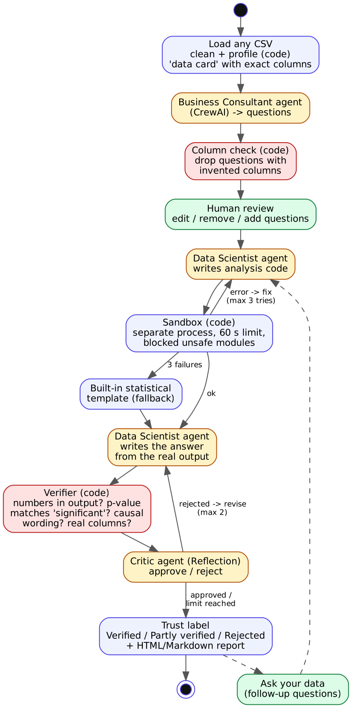

# Verified Data Analyst Agent

A multi-agent data analyst built with **CrewAI**. Give it any CSV. It works out which questions are worth asking, writes and runs the analysis code, and explains the results. A **Critic agent** and an automatic **verifier** check **every number and claim against the real code output** before anything reaches the report. Each finding gets a trust label: ✅ Verified, ⚠️ Partly verified or ❌ Rejected.



## Where it comes from, and what is new

This project starts from the **"Building a Data Analyst AI Agent"** DataHour session (Analytics Vidhya, by Srimugunthan Dhandapani; original code at https://github.com/srimugunthan/data-analyst-crewAI, itself based on [Manaranjan Pradhan's blog post](https://medium.com/@manaranjanp/building-a-collaborative-ai-agent-framework-for-automated-eda-using-crewai-351478b424ce)). That project uses three CrewAI crews: a Junior Data Analyst, a Business Consultant (questions) and a Data Scientist (code and plots).

This version is rewritten. These are the improvements:

| Original project | This project |
|---|---|
| One hard-coded dataset, file paths and metadata file | **Any CSV**: automatic cleaning, profiling and dataset description |
| OpenAI key hard-coded in `main.py` (`.env` committed) | Free **Groq** key in `.env` or the app; falls back to other models when one hits its daily limit |
| LLM code run with `exec()` inside the app | **Sandbox**: separate process, 60-second limit, unsafe modules blocked |
| A crashed analysis is lost | **Self-repair**: the error is sent back to the agent (up to 3 tries), then a built-in statistical template |
| Summaries are trusted as written | **Verifier and Critic agent** (Reflection pattern) check numbers, p-values, causal wording and column names; wrong answers are revised (up to 2 times) |
| Questions can name columns that don't exist | Questions with invented columns are dropped and replaced |
| No user control | **Human in the loop**: edit, remove or add questions before the analysis runs |
| Data cleaning was a TODO | Cleaning step: index columns, duplicates, text-encoded numbers, empty columns |
| Command line only | **Streamlit app**, **Ask your data** follow-up questions, HTML/Markdown report |
| No tests | **25 automated tests**, run offline with a scripted model inside the real CrewAI crews |

## Setup (Windows)

```
python -m venv .venv
.venv\Scripts\activate
pip install -r requirements.txt          (CrewAI is large: allow 5-10 minutes)
python -m pytest -q                      (should say 25 passed)
python -m streamlit run app.py
```

Paste a free Groq key (https://console.groq.com/keys) into the sidebar. It's saved to `.env` and never committed. Without a key, the app runs in **Demo mode**, which uses built-in statistical templates.

Command line: `python main.py data/heart_disease.csv --describe data/heart_disease_description.txt --questions 3`

## How it works

| File | Role |
|---|---|
| `dataagent/profiler.py` | load any CSV, clean it, profile it; the "data card" gives agents the exact column names |
| `dataagent/crews.py`, `config/*.yaml` | CrewAI agents: Business Consultant, Data Scientist, Critic |
| `dataagent/sandbox.py` | runs agent-written code in a separate process with a time limit |
| `dataagent/verifier.py` | checks numbers, p-value vs "significant", causal wording, column names |
| `dataagent/templates.py` | built-in t-test, ANOVA, chi-square, correlation and distribution analyses (demo and fallback) |
| `dataagent/pipeline.py` | the workflow: plan, then code, run, repair, answer, verify, critique, label |
| `dataagent/llm.py` | Groq adapter for CrewAI (`BaseLLM`) with model fallback |
| `app.py`, `main.py` | web app and command line |

## Limitations

- The sandbox is a practical guard, not a security boundary. Only analyse data you trust.
- The verifier checks *numbers and wording*, not whether the chosen statistical test is the best one; that is the Critic agent's job.
- The sample data (South African heart disease study, Rousseauw et al. 1983) is observational, so findings are associations, not causes.
